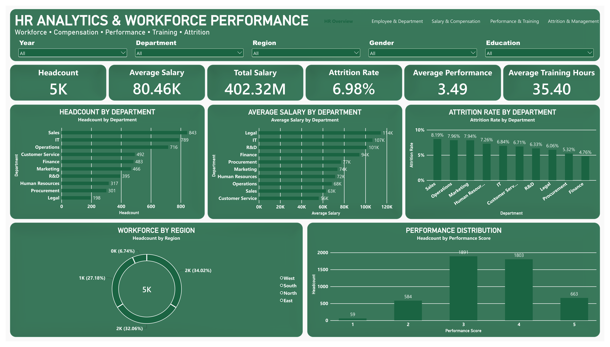

# HR Analytics & Workforce Performance | Power BI

A Power BI HR analytics project that explores workforce composition, departmental headcount, salary and bonus distribution, employee performance, training, and attrition using a synthetic practice dataset.

## Project Overview

This project demonstrates how **Power BI, DAX, Excel, and data modeling** can turn HR data into an interactive workforce dashboard for recruiters, hiring managers, and business stakeholders. The five report pages support analysis from overall workforce KPIs to department-level performance and employee attrition.

> **Dataset notice:** This is a synthetic/practice dataset created for portfolio and analytical demonstration. The results do not represent a real employer or workforce.

## Key Metrics

| KPI | Project Result |
|---|---:|
| Employees / Headcount | 5,000 |
| Total Salary | ₹402.32M |
| Average Salary | ₹80,465 |
| Median Salary | ₹75,440 |
| Average Bonus | ₹9,469 |
| Bonus-to-Salary Ratio | 11.77% |
| Attrition Rate | 6.98% |
| Employees Who Attrited | 349 |
| Average Performance Score | 3.49 / 5 |
| Average Training Hours | 35.40 |
| Average Employee Age | 33.95 |
| Average Tenure | Approximately 6.42 years |
| Female Workforce | 45% |
| High Performers (Scores 4–5) | 2,466 (49.32%) |
| Low Performers (Scores 1–2) | 643 (12.86%) |

## Dashboard Pages

### 1. HR Overview
Provides a high-level view of headcount, compensation, attrition, performance, training, age, tenure, and workforce composition.



### 2. Employee & Department Analysis
Explores workforce distribution by department and region, with demographic and job-related breakdowns.


### 3. Salary & Compensation
Compares total and average salary, median salary, bonuses, bonus-to-salary ratio, and compensation across departments.


### 4. Performance & Training
Reviews employee performance-score distribution and training hours across departments.


### 5. Attrition & Management
Examines attrition levels and supporting workforce indicators to help identify areas for further HR investigation.


## Selected Insights

- **Sales** has the largest department headcount (843) and the highest department attrition rate (8.19%).
- **Legal** has the highest average salary (approximately ₹114K).
- **Finance** has the lowest department attrition rate (4.76%).
- The **West** and **South** regions account for the largest workforce shares.
- **49.32%** of employees fall into the high-performer group based on performance scores of 4–5.
- Average training time is **35.40 hours**; the dashboard enables comparison with performance results but does not establish causation.

These observations describe patterns in the synthetic dataset and should not be interpreted as evidence of real-world causes.

## Tools & Skills Demonstrated

- **Power BI:** interactive dashboards, report navigation, slicers, KPI cards, charts, and matrix visuals
- **DAX:** workforce, compensation, performance, training, and attrition measures
- **Microsoft Excel:** source dataset preparation and structured tables
- **Data Modeling:** fact-and-dimension-oriented structure for employee, department, job, location, and date analysis
- **Data Storytelling:** translating workforce indicators into concise, stakeholder-friendly findings

## Dataset Structure

The supplied Excel workbook (`HR_Analytics.xlsx`) contains these sheets:

| Sheet | Purpose |
|---|---|
| `FactHR` | Employee-level HR measures and dimension keys |
| `DimEmployee` | Employee attributes and demographics |
| `DimDepartment` | Department lookup |
| `DimJob` | Job lookup |
| `DimLocation` | Location / region lookup |
| `DimDate` | Date attributes |
| `Project_Info` | Project and dataset information |

The dataset contains **5,000 employee records** in the employee fact table and is intended for practice and portfolio use.

## Repository Files

Suggested repository layout:

```text
HR-Analytics-Power-BI/
├── README.md
├── HR_Analytics.pbix
├── HR_Analytics.xlsx
└── screenshots/
    ├── hr-overview.png
    ├── employee-department-analysis.png
    ├── salary-compensation.png
    ├── performance-training.png
    └── attrition-management.png
```

Place the five rendered screenshots in the `screenshots/` folder using the filenames shown above. The Markdown image links are relative paths, so they will display correctly after those images are committed to GitHub.

## Business Questions Explored

- How is the workforce distributed across departments and regions?
- How do salary and bonus levels vary by department?
- What does the performance-score distribution look like?
- How much training do employees receive across departments?
- Which departments show higher or lower attrition rates?
- Which workforce patterns may warrant further HR review?

## Author

**Altamash Nizamuddin**  
Data Analyst | Excel • Power BI • Python • MySQL  
Mumbai, India

- GitHub: [@altamash-analyst](https://github.com/altamash-analyst)
- Email: [altamash9876@gmail.com](mailto:altamash9876@gmail.com)

Open to Data Analyst, Business Analyst, BI Analyst, and Power BI Developer opportunities.

## AI Assistance Disclosure

AI tools were used to assist with documentation and wording. The project metrics and descriptions are based on the supplied project files; the author is responsible for reviewing and validating the final analysis.

## GitHub Repository Metadata

**Repository name:** `HR-Analytics-Power-BI`

**Suggested repository description:**

> HR Analytics Power BI dashboard analyzing 5,000 synthetic employee records across workforce headcount, salary, bonuses, performance, training, and attrition using DAX and Excel.

**Recommended GitHub topics:**

`power-bi` `hr-analytics` `human-resources-analytics` `workforce-analytics` `employee-attrition` `data-analytics` `dax` `microsoft-excel` `business-intelligence` `dashboard` `Altamash-Analyst`

---

*Portfolio project for demonstrating HR analytics, dashboard design, data modeling, and business intelligence skills.*
